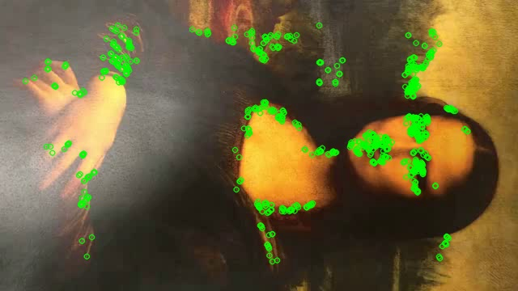
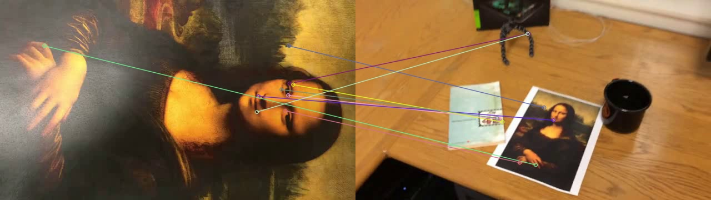
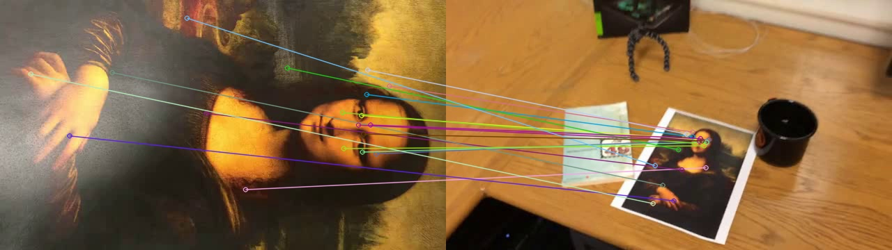
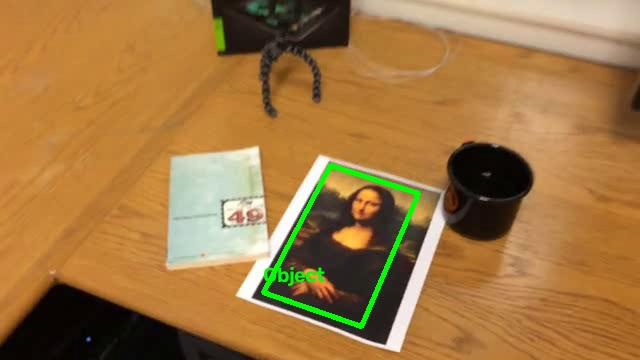

# Простейший алгоритм трекинга объекта на видео на основе ключевых точек.

[Текст задания](./docs/task.md)

## Теоретическая база

- SIFT --- Scale-Invariant Feature Transform, преобразование признаков, инвариантных к масштабу.
- KNN --- K-Nearest Neighbors, K ближайших соседей.
- LRT --- Lowe Ratio Test, проверка отношения расстояний Лоу.
- RANSAC --- Random Sample Consensus, метод случайных выборок для поиска согласованной модели.
- BFMatcher --- Brute-Force Matcher, сопоставление полным перебором.

Трекинг объекта основан на сопоставлении характерных точек изображения между кадрами. 
SIFT позволяет находить признаки, устойчивые к изменению масштаба и повороту. 
По соответствующим точкам с помощью RANSAC вычисляется матрица гомографии, которая позволяет определить положение плоского объекта на текущем кадре.

## Описание разработанной системы (алгоритмы, принципы работы, архитектура)

В системе выстроен следующий пайплайн обработки видео:

    
SIFT --- выделение признаков

    SIFT.detectAndCompute() -> ключевые точки (KeyPoint) и их 128-мерные дескрипторы (ndarray).

    
KNN + Lowe Ratio Test --- поиск соответствий

    knnMatch() -> для каждого дескриптора источника список из двух ближайших совпадений (DMatch).
    Сравнение осуществляется сначала с эталоном, затем с предыдущим состоянием.

    
RANSAC + Homography

    findHomography() -> матрица гомографии 3*3 и маска инлайеров.

    
Геометрические проверки

    Проверяются количество и доля инлайеров, конечность координат углов, выпуклость рамки, её площадь и допустимое отклонение от границ кадра.

В качестве эталона используется первый кадр видео. 
На каждом следующем кадре объект сначала ищется по эталону, а при неудаче --- по признакам последнего успешного обнаружения. 
После обнаружения обновляются признаки объекта и координаты его рамки.

## Результаты работы и тестирования системы

<!-- TRACKING TABLE START -->

| Видео | Кадров | По эталону | По предыдущему состоянию | Доля обнаружений |
|---|---:|---:|---:|---:|
| mona-lisa.avi | 558 | 231 | 327 | 100.0% |

<!-- TRACKING TABLE END -->

| mona-lisa.avi      | mona-lisa-blur.avi      |
|--------------------|-------------------------|
|  |  |

## Выводы по работе
## Использованные источники
